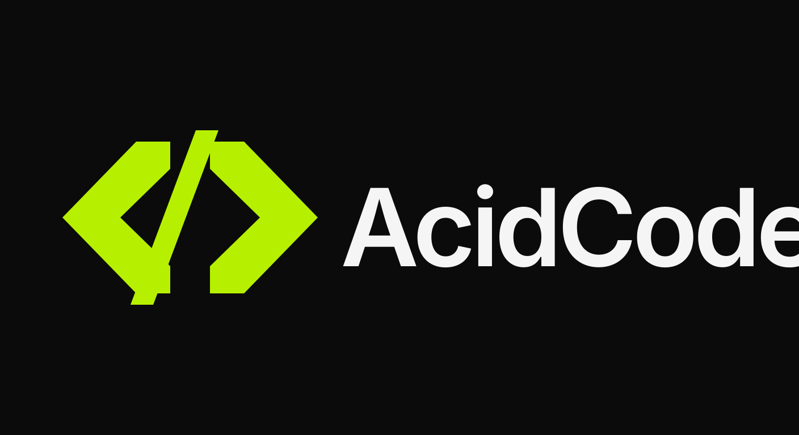

# AcidCode

<p align="center">
  
</p>

Терминальный кодовый ассистент на Python 3.13. Чат со стримингом, вызов инструментов,
сессии, тёмный интерфейс с кислотно-зелёным акцентом. Работает с любым
OpenAI-совместимым бэкендом.

Интерфейс разделён на две панели: слева — файл, diff или результат инструмента,
справа — диалог с моделью. Внизу — строка ввода с текущей моделью и расходом токенов.

## Установка (один раз)

Двойной клик по `install.bat` в этой папке. Он создаст `.venv`, подтянет зависимости
и поставит пакет в этот venv.

Или вручную из папки проекта:

```bat
python -m venv .venv
.venv\Scripts\python.exe -m pip install -e .
```

## Запуск

Из папки `C:\Users\Asus\AcidCode`:

```bat
acidcode.cmd
```

или

```bat
.venv\Scripts\python.exe -m acidcode
```

Если хочешь команду `acidcode` из любой папки — добавь
`C:\Users\Asus\AcidCode\.venv\Scripts` в PATH.

Запускать из папки проекта — она становится рабочей директорией инструментов.

## Первый ключ, три шага

1. `/provider groq` — выбрать бэкенд
2. `/key gsk_...` — вставить ключ
3. написать сообщение

Проверка: `/status`, список моделей: `/models`, выбор: `/model llama-3.3-70b-versatile`.

## Команды

| команда | что делает |
|---|---|
| `/help` | справка |
| `/providers` | все бэкенды и ссылки на ключи |
| `/provider <имя>` | сменить бэкенд |
| `/key <ключ>` | сохранить ключ |
| `/model <имя>` | выбрать модель |
| `/models` | рейтинг: ТОП/СРЕДНЯК/КАЛ + метка бесплатно/платно + расход |
| `/models free` | только бесплатные модели |
| `/models paid` | только платные модели |
| `/models top` | только верхний дивизион (`mid`, `bad`, `топ`, `среднее`, `кал` тоже работают) |
| `/switch <n>` | перейти на модель по номеру |
| `/switch next` | следующая доступная модель |
| `/usage` | расход бюджета по моделям |
| `/usage reset` | сбросить счётчики |
| `/lang ru\|en` | язык интерфейса (по умолчанию русский) |
| `/theme <имя>` | цвета: `acid`, `amber`, `ice`, `violet`, `mono` |
| `/update` | установить обновление из `update_url` |
| `/update check` | только проверить, есть ли новая версия |
| `/update <путь>` | обновиться из папки или URL |
| `/system <текст>` | системный промпт |
| `/reasoning <ур>` | thinking deepseek: off/low/high/max |
| `/status` | текущее состояние |
| `/new` | новый чат |
| `/save [имя]` | сохранить сессию |
| `/load <имя>` | загрузить сессию |
| `/sessions` | сохранённые сессии |
| `/clear` | очистить экран |
| `/exit` | выход |

Клавиши: `enter` отправить, `ctrl+c` выход, `ctrl+n` новый чат, `ctrl+s` сохранить, `f1` справка.

## Инструменты

Модель сама вызывает: `read_file`, `write_file`, `edit_file`, `list_dir`,
`glob_search`, `grep_search`, `run_shell`. Всё ограничено рабочей папкой запуска.
`run_shell` — powershell на Windows, bash на linux/mac, таймаут 120 с.

## Где взять бесплатные ключи

Лимиты меняются, цифры проверяй на странице провайдера.

| провайдер | где взять | что дают |
|---|---|---|
| OpenRouter | openrouter.ai/keys | модели с суффиксом `:free`, ~50 запросов/день |
| Google AI Studio | aistudio.google.com/apikey | Gemini 2.5 Flash, бесплатный tier |
| Groq | console.groq.com/keys | очень быстрый инференс, щедрый free tier |
| Cerebras | cloud.cerebras.ai | бесплатный tier, ~1M токенов/день |
| Mistral | console.mistral.ai/api-keys | план Experiment бесплатно |
| GitHub Models | github.com/settings/tokens → право `Models: read` | GPT-4o-mini и другие, дневные лимиты |
| SambaNova | cloud.sambanova.ai | бесплатный tier, Llama 70B |
| NVIDIA NIM | build.nvidia.com | 1000 бесплатных кредитов |
| Together AI | api.together.ai/settings/api-keys | бесплатные Llama-модели |
| Fireworks | fireworks.ai/account/api-keys | стартовые кредиты |
| Cloudflare Workers AI | dash.cloudflare.com | 10k neurons/день |
| HuggingFace | huggingface.co/settings/tokens | бесплатные inference-кредиты |
| Cohere | dashboard.cohere.com/api-keys | trial-ключ |
| Hyperbolic | app.hyperbolic.xyz | стартовые кредиты |
| Chutes | chutes.ai | бесплатный tier |

### Без ключа вообще

- Pollinations — уже в списке, `/provider pollinations`
- Ollama — `ollama pull qwen2.5-coder:7b`, затем `/provider ollama`
- LM Studio — локальный сервер на `127.0.0.1:1234`, `/provider lmstudio`

### GitHub Models, подробно

1. github.com/settings/tokens → Generate new token (fine-grained)
2. доступ `Models: read`
3. `/provider github`
4. `/key github_pat_...`
5. `/model openai/gpt-4o-mini`

## Конфиг

`C:\Users\Asus\.acidcode\config.json` (или `~/.acidcode/config.json`).

```json
{
  "provider": "groq",
  "model": "llama-3.3-70b-versatile",
  "system": "Ты AcidCode...",
  "temperature": 0.3,
  "max_steps": 25,
  "lang": "ru",
  "theme": "acid",
  "update_url": "C:\\Users\\Asus\\YandexDisk\\AcidCode\\dist\\latest.json",
  "update_check": true,
  "update_auto": true,
  "providers": {
    "groq": { "api_key": "gsk_..." },
    "openrouter": { "api_key": "sk-or-..." }
  }
}
```

Ключ можно держать в переменной окружения:

```powershell
$env:GROQ_API_KEY = "gsk_..."
```

Переменные: `OPENROUTER_API_KEY`, `GEMINI_API_KEY`, `GROQ_API_KEY`,
`CEREBRAS_API_KEY`, `MISTRAL_API_KEY`, `GITHUB_TOKEN`, `SAMBANOVA_API_KEY`,
`NVIDIA_API_KEY`, `TOGETHER_API_KEY`, `FIREWORKS_API_KEY`, `DEEPSEEK_API_KEY`,
`OPENAI_API_KEY`, `ANTHROPIC_API_KEY`.

Платные, но уже подключены в AcidCode: OpenAI (`platform.openai.com`), Anthropic
(`console.anthropic.com`), DeepSeek. Ключи принимаются, чат идёт после пополнения баланса.
Anthropic работает через OpenAI-совместимый шлюз `api.anthropic.com/v1`.

Сессии: `~/.acidcode/sessions/*.json`.

## Бюджет моделей

На каждую модель — свой лимит, по умолчанию 200 000 токенов (оценка по символам).
Счётчики лежат в `~/.acidcode/usage.json`, бюджет меняется в `config.json`:

```json
{ "model_budget": 200000 }
```

- `/models` показывает рейтинг: сверху ТОП, снизу КАЛ, у каждой строки метка
  `[бесплатно]` или `[платно]`, полоса расхода и наличие ключа.
- Фильтры: `/models free`, `/models paid`, `/models top`, `/models mid`, `/models bad`.
  Русские синонимы (`бесплатно`, `платно`, `топ`, `среднее`, `кал`) тоже работают.
- `/switch 4` — перейти на модель номер 4 из списка (нумерация общая для всех фильтров).
- `/switch next` — лучшая доступная модель с ключом и остатком бюджета.
- Когда бюджет текущей модели кончился, AcidCode сам переключается на следующую
  по рейтингу и пишет строку `↷ переключился на ...`.
- `/usage reset` обнуляет все счётчики, `/usage reset google` — только Google.

## Язык интерфейса

`/lang ru` или `/lang en`. Язык хранится в `config.json` (`"lang": "ru"`).
Меняются баннер, placeholder, справка, рейтинг, расход, статус и подписи клавиш
в нижней строке. Провайдеры и модели — без перевода.

## Загрузка и анимация

- На старте — экран `WEXOV PRODUCTION`, гаснет через 2 секунды или по любой клавише.
- Пока модель думает — крутится ASCII-планета: 18 кадров, 0.07 с на кадр.
  Континенты сдвигаются по широте (у экватора быстрее), корпус не дёргается.
- Планета гаснет на первом токене ответа, а не на рассуждениях, и держится
  минимум 0.35 с — без мигания на быстрых моделях.

## Цвета интерфейса

```text
/theme acid      тёмно-зелёная (по умолчанию)
/theme amber     чёрно-янтарная
/theme ice       тёмно-синяя, голубой акцент
/theme violet    фиолетовая
/theme mono      графит и белый
```

`/theme` без аргумента показывает список и отмечает текущую звёздочкой.
Выбор хранится в `config.json` (`"theme": "acid"`) и применяется сразу,
без перезапуска. Палитры лежат в `acidcode/themes.py`, все цвета в `theme.tcss`
идут через переменные `$acid-*`.

## Установка у друга

`release.cmd` собирает два архива:

- `dist\acidcode-<версия>.zip` — только файлы обновления;
- `dist\AcidCode-<версия>-friend.zip` — установка с нуля.

Другу:

1. Поставить Python 3.13 с `python.org` (отметить `Add python.exe to PATH`)
   или из Microsoft Store.
2. Распаковать `AcidCode-<версия>-friend.zip`, например в `C:\AcidCode`.
3. Один раз запустить `install.bat` — он создаст `.venv` и поставит зависимости.
4. Запустить `acidcode.cmd`.
5. Выбрать провайдера:
   ```text
   /provider google
   /key <ключ>
   ```
   или без ключа:
   ```text
   /provider pollinations
   /model openai
   ```
6. Для автообновлений один раз выполнить:
   ```text
   /update \\server\share\acidcode\latest.json
   ```
   Путь запомнится в `update_url`, дальше обновления приходят сами.

В архиве лежит `SETUP.txt` с этими же шагами.

## Обновления для друга

Обновления идут через файл-манифест: подходит и общая папка (Яндекс.Диск, OneDrive,
сетевая), и обычный HTTP-хостинг.

На твоей машине:

```bat
release.cmd
```

Появятся `dist\acidcode-<версия>.zip` и `dist\latest.json` с версией и sha256.
Положи оба файла в общую папку или выложи на статичный хостинг.

У друга в `~/.acidcode/config.json`:

```json
{
  "update_url": "C:\\Users\\Friend\\YandexDisk\\AcidCode\\dist\\latest.json",
  "update_check": true,
  "update_auto": true
}
```

- `acidcode` проверяет канал **до** запуска TUI;
- если версия новее — скачивает архив, сверяет sha256, заменяет файлы пакета
  и перезапускает сам себя;
- после старта у друга уже новая версия, ничего нажимать не нужно;
- `/update` — обновиться вручную, `/update check` — только проверить,
  `/update <папка|URL>` — поставить и запомнить источник в `update_url`;
- если `update_auto: false`, приложение только покажет `↻ есть версия ...`
  и установит по `/update`.

Если сеть/папка недоступны, автообновление молча пропускается, приложение
запускается на текущей версии.

Без TUI:

```bat
acidcode.cmd update
acidcode.cmd update check
acidcode.cmd update C:\путь\к\latest.json
```


## Частые проблемы

| симптом | причина | что делать |
|---|---|---|
| 'acidcode' is not recognized | пакет не установлен / venv не активирован | запускай `acidcode.cmd` из папки проекта |
| `# или` → not recognized | `#` это комментарий bash, cmd такого не понимает | одна команда на строку |
| 401 | ключ не тот или не для этого провайдера | `/status`, потом `/key` заново |
| 404 model not found | имя модели устарело | `/models`, взять актуальное |
| пустой ответ | free-эндпоинт режет стриминг | сменить модель или провайдера |
| инструменты не вызываются | бэкенд не умеет tool calling | повторится запрос без tools, чат работает |
| `run_shell` молчит | нет `powershell` в PATH | поставить PowerShell 7 |
